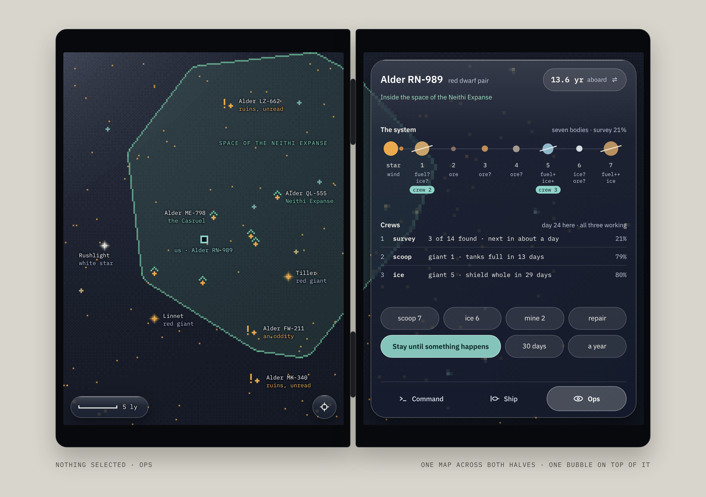

# ClaudeSpaceFiction

A text prototype for **Lightspeed**: a forever cruise on a relativistic worldship. You are the navigator, woken by the ship's Mind when there is something to decide. Arrive, sweep the system, put crews to work, stay as long as it pays, pick the next star, burn.

The point of the prototype is to find out what is fun before anything is drawn.

## Play

`docs/index.html` is the whole game in one file. Open it in a browser, or serve the `docs/` folder with GitHub Pages. Type commands or tap the buttons; `help` lists everything. The voyage saves itself in the browser, and the menu can copy it out as text.

A link ending in `#seed-12345` (or `?seed=12345`) opens that galaxy, so two people can explore the same sky.

In a terminal:

```
npm install
npm run play                  # interactive
node tools/play.ts sweep ops  # run some commands and exit
```

## What is in this slice

- **The loop.** `sweep` a system, assign crews (`scoop` fuel from giants, cut `ice` for the forward shield, `mine` stock for the hold, `survey`, deep `scan` oddities, `repair`), let days pass with `stay`, then `chart`, `plot` and `burn`. `look` shows the system and what each crew is doing; `ship` shows the ship and its refits.
- **Two clocks.** Every trip costs time aboard and more time outside.
- **Gas sets the speed.** In gas of density n the ship cruises at gamma = sqrt(1 + P / n), where P grows with engine thrust and hull grade. Thin gas is fast; clouds are walls for a young ship. `chart far` shows where it lies.
- **Two ways to burn.** `burn` goes at full thrust. `burn eco` goes at a quarter: fuel use goes as thrust squared, so it is far cheaper, but it takes about twice as long and time under way wears the hull.
- **A guided first visit.** On a new voyage the Mind explains each step once, then stops.
- **Charts at three zooms.** `chart close` is the nearest stars. `chart` is what stands out in a view four times wider: signals, things worth a deep scan, bright stars. `chart far` is the bright stars to steer by, four times wider again. Each draws a small map in characters and lists what it numbers, says which of them the tanks can reach, and says whose space you are in or near. `plot` takes a number from whichever chart was shown last, or a star's name, and says what the telescopes see there as well as what the trip costs.
- **Five materials, each from its own kind of place.** Volatiles from beyond the snow line, metals from rock, carbon from carbon-rich bodies and the winds of old giant stars, isotopes from giant planets, heavy elements from the debris of dead stars. They share one hold. The survey says what a body holds; `mine 3 carbon 45` takes a named material, and only as much as asked.
- **Seams thin out.** A whole system does not run dry, but the easy part of each seam does, slowly, and what you took is remembered if you come back. People who live in a system have already thinned its seams. Given a million years or so, a seam recovers.
- **Hot work.** A few bodies, very close to their star or round a pulsar or a black hole, cost hull or shield for every day a crew works them. The Mind says so, and pulls the crew off before it costs too much.
- **Refits.** Knowledge in the Archive unlocks them; particular materials and crew time pay for them. The early ones need what is common, the last ones need heavy elements, so the far chart becomes a ladder.
- **The Mind.** A written voice with its own tastes, a dissent it logs and later checks, and a habit of noticing how you leave places.
- **Other people.** About one system in a hundred is somebody's home, more in the old cluster where the voyage starts. None of them are human. Each culture is born, rises, declines and ends; a few spread to hold the stars around them for a while. Their radio shows as `^` on the charts, as old as the light that carries it. Come back after a long haul and they may have changed, or be gone.
- **Ruins and relics.** A culture that has ended leaves ruins for a few thousand years, and then nothing. The chart flags unread ruins close by, a sweep picks them out, and a deep scan says whose they were and now and then brings something back for the hold.

Not here yet: dealing with the people you meet (terms, tolls, trade, and what happens when you ignore them), other ships and their invitations, the permanent waypoint systems, marks the navigator leaves behind, and transients.

## How it is built

TypeScript, no framework, no runtime dependencies. The game core never touches the page, so the same code runs in the browser, in a terminal and under the bot.

| File | What it holds |
|---|---|
| `src/core/config.ts` | Every tunable number: galaxy size, drive physics, materials and work rates, refit recipes |
| `src/core/rng.ts` | Integer hashing; one substream per purpose |
| `src/core/galaxy.ts` | Where systems are and how thick the gas is, generated per cell on demand |
| `src/core/system.ts` | Stars, bodies, what can be mined from them and what a survey finds, as a pure function of seed and id |
| `src/core/features.ts` | The catalogue of natural oddities, with their text |
| `src/core/civs.ts` | Who lives where and when: cultures, the space they hold, their ruins |
| `src/core/cultures.ts` | The tables a culture is invented from: names, bodies, habits, what they leave |
| `src/core/travel.ts` | Trip planning: both clocks, fuel and shield |
| `src/core/mind.ts` | The Mind's lines and how one is chosen |
| `src/core/state.ts` | What gets saved |
| `src/core/game.ts` | The commands |
| `src/web/` | The page |
| `tools/` | Build script, terminal player, the bot, and the census of who is out there |
| `media/` | Concept art for a later, more visual version, and a small renderer for narrated code-walkthrough videos |

Nothing about the galaxy is stored. A save holds the ship, the clocks and what the navigator has seen; everything else is regenerated from the seed. That includes history: who is home at a system in a given year is a function of the seed, the system and the year, so the galaxy can be asked about any date without ever being stepped through time. The demo galaxy is a 6,000 light-year disc of three million systems. `radius` and `totalSystems` in `config.ts` make it larger, up to a few hundred million systems; a full hundred billion needs the disc to have thickness first.

The game is meant to be played for a very long time, so every mechanic is held to one question: would this still work with a hundred billion stars, ten thousand trips and a billion years on the clock? In practice that means nothing the navigator does is kept for ever. A worked seam recovers, peoples of whom nothing is left drop off the list, and a remembered system is stored in a few dozen bytes.

## Working on it

```
npm run check    # typecheck
npm test         # determinism, calibration, physics, cultures, saves, layout width
npm run build    # writes docs/index.html
npm run bot      # a bot flies 150 jumps and reports pacing, repeated lines and who it met
node tools/bot.ts --jumps 500 --seed 7 --transcript > flight.txt
npm run census   # how many cultures, outposts and ruins there are, and where each material is found
```

`docs/index.html` is generated; edit `src/` and rebuild.

## Media

`media/` holds things about the game that are not the game. `media/concepts/` has concept art for a later version with more to look at: the same game as an app on a two-screen phone, with the star chart across the whole device and everything else in one pane of glass on top of it. `media/video/` can turn a short script into a narrated video that quotes this repository's real code, for making tutorials. `media/README.md` shows the pictures and explains both.


