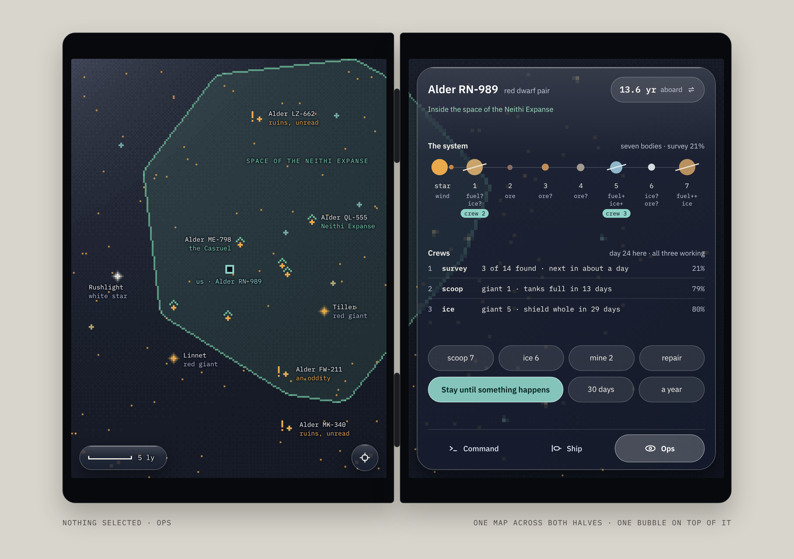
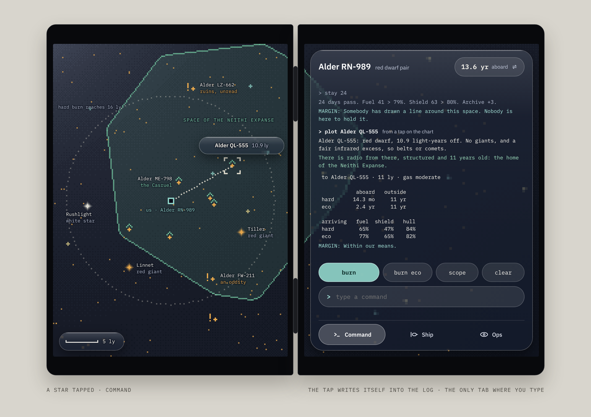
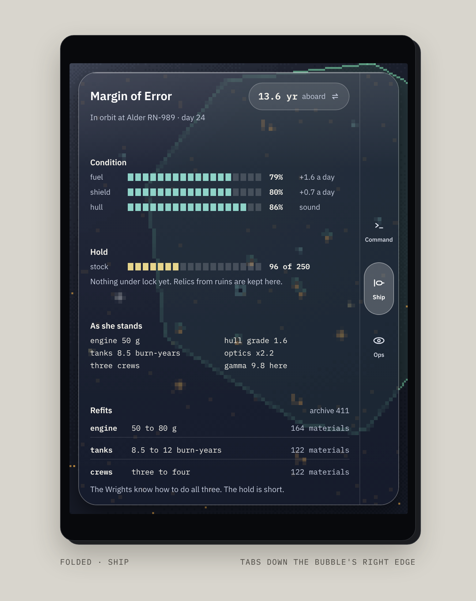

# Media

Pictures and video about Lightspeed: concept art for where the game could go, and a small renderer for narrated walkthroughs of the code. Nothing in this folder is needed to play or build the game.

| Folder | What it holds |
|---|---|
| `concepts/` | Concept art and schematics: what a later, more visual version might look like |
| `video/` | A renderer that turns a script into a narrated video about this repository |

## Concept: Lightspeed on a two-screen phone

The game today is text on a terminal-like page. These pictures sketch the same game as a phone app, on a device that folds open into one wide screen. They are concept art. None of it is built.

The idea, in four parts:

- **One map.** Opened, the device is one big screen, and the star chart runs right across it. You move around it by hand; there are no zoom buttons.
- **One bubble.** Everything else sits in a single pane of glass over the right half of the map. It has three tabs: Command, Ship and Ops.
- **Glass over pixels.** The world stays chunky. The controls are smooth glass, and instead of blurring what lies behind them they show it at twice the pixel size.
- **One clock.** The two clocks become one small reading in the corner. Tap it to switch between years aboard and years outside.

### Nothing selected: Ops



With no star selected, the bubble shows where you are: the system as a row of bodies, what each crew is doing, the work on offer, and how long to stay. There is nothing to type here.

### A star tapped: Command



Tapping a star draws the course and the reach of a hard burn on the map, and switches the bubble to Command. The tap writes its own line into the log, followed by what the telescope sees and what the trip would cost, with the burns offered as buttons. Command is the terminal the game is today, and the only tab with a text field.

### Folded: Ship



Folded shut, the phone has one screen. The map is still underneath, and the tabs move to the right edge of the bubble, under the thumb. The Ship tab has the ship's condition, the hold, and the refits within reach.

### What is real in them

The map is the actual galaxy on the default seed: a seven-body system inside the space of a spreading culture, two unread ruins, an oddity, and the true course to that culture's home world. The system, the work rates and the trip times are the game's own numbers.

The moment is staged, with all three crews conveniently busy. The ring showing how far a hard burn reaches is invented: the game does not work that out yet.

## Concept: the ship as a city

How the ship itself might be looked at and managed. This one is a working schematic, not a painting: open `concepts/ship-view.html` in a browser and turn it.


- **A spine with districts built outward from it**, in tiers, on every side.
- **One cut at a time.** The ship is cut along a plane through the spine and seen from above. The districts lying in the cut spread out to either side, the ones beneath show past them, and the ones above are taken away.
- **Turn the ship** to bring the next part of the city into the cut.
- **The body the ship is parked at lies below it**, with the star behind.

The districts are made up, and the final ship will look different. The way of seeing it is the part that is settled. `concepts/ship-view.md` describes it closely enough to rebuild.

## Narrated videos

`video/` is a small renderer that turns a script into a narrated video, for tutorials about this repository. A film is mostly moving type: titles, file lists, diagrams, real code with lines lighting up as they are discussed, and real output from the game. Captions are on screen throughout.

```
node media/video/render.ts example                     # writes dist/video/example.mp4
node media/video/render.ts example --voice bm_george   # the same, in another voice
node media/video/render.ts example --times             # also print when each scene starts
node media/video/render.ts example --stills 5,12       # write still frames at those seconds instead
```

`npm run video example` does the same as the first line. Output goes to `dist/`, which is not committed.

### Writing a film

A film is one file in `video/films/` that exports `film`. `video/films/example.ts` is a short working one to copy. The shapes are in `video/types.ts`.

A film is a list of **scenes**. A scene is a picture plus the sentences spoken over it. Each sentence is one caption and one sound file, so captions and voice cannot fall out of step.

Things on screen carry a **step** number and appear when the narration reaches it. By default the first sentence of a scene is step 0, the second step 1, and so on; a sentence can name its step to hold the picture still for longer.

| Kind | What it draws |
|---|---|
| `title` | A large title with a line above and below |
| `big` | A few large statements, revealed in turn |
| `tree` | A list of files or terms with a note beside each |
| `split` | Two halves and a one-way arrow between them |
| `fan` | Several callers pointing at one thing |
| `code` | Real code from the repository, with lines lit by step and an optional second block for comparison |
| `flow` | A pipeline, top to bottom |
| `type` | The game's input line with a command being typed |
| `console` | Real output from the game for given commands |
| `cmds` | Two columns of short entries |

A sentence can carry `say`, a spelling for the voice alone, when a word would be mispronounced. The caption keeps the real spelling. Words that come up everywhere are listed once in `SAY` at the top of `video/render.ts`.

### Quoting real code

A `code` scene names a file and either the text of its first line plus a count, or a list of texts each identifying one line. `video/snippets.ts` finds them when the film is rendered and fails if any has gone, and `test/video.test.ts` runs the same check on every film. A film cannot quietly drift away from the source it describes.

`console` scenes are real too: the game is run with the listed commands at render time.

### How a film is made

1. `snippets.ts` pulls the quoted code out of the source files.
2. `render.ts` speaks each sentence to a sound file and lays the sentences end to end. That gives the timing; nothing is timed by hand.
3. `player.ts` draws the film in a headless browser as a pure function of time, so frames can be asked for in any order.
4. `ffmpeg` joins the frames and the sound track.

Because scenes are timed from the recorded sentences, a different voice or speaking speed simply produces a film of a different length.

### Set-up

Needs `ffmpeg`, the IBM Plex fonts (Ubuntu package `fonts-ibm-plex`), Playwright with Chromium, and a voice.

The narrator is [Kokoro](https://huggingface.co/hexgrad/Kokoro-82M), a small open-source neural voice that runs on an ordinary processor. Once per machine:

```
pip install kokoro-onnx soundfile
mkdir -p ~/.cache/kokoro && cd ~/.cache/kokoro
curl -LO https://huggingface.co/fastrtc/kokoro-onnx/resolve/main/kokoro-v1.0.onnx
curl -LO https://huggingface.co/fastrtc/kokoro-onnx/resolve/main/voices-v1.0.bin
```

Voice names starting with `a` are American and `b` British; the second letter is `f` or `m`. `am_michael` is the default. Sound files are cached by voice and text, so a second render only speaks what changed.

`--voice pico` uses SVOX Pico instead (Ubuntu package `libttspico-utils`). It needs no model download and sounds much more mechanical.
